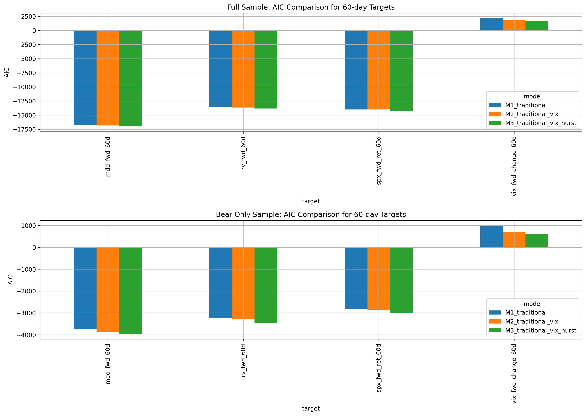

# Identifying Risk-Recovery Regimes in the S&P 500
### A VIX–Hurst empirical research project | 基于 VIX–Hurst 的标普500风险修复状态识别

**Research status:** Undergraduate research project · preliminary **in-sample** findings · not peer reviewed.  
**Main study period:** 2000–2024 · **Tool:** Python, pandas, NumPy, SciPy, statsmodels, Matplotlib.

## Overview

This project studies whether the **DFA-Hurst exponent of daily changes in log(VIX)** offers incremental information about potential risk-recovery regimes in the S&P 500, beyond conventional market indicators and VIX-level/directional measures. The aim is **risk-state identification**, not market-bottom prediction or a claim of profitable trading.

## Research design

- **State variables:** S&P 500 vs. 200-day moving average; VIX vs. its rolling 252-day 80th percentile; 5-day change in VIX. 
- **Volatility persistence:** Rolling DFA-Hurst of Δlog(VIX), with 45/60/90/120-trading-day windows; 90 days is the main specification.
- **Core composite state:** Bear market + elevated VIX + falling VIX + Hurst(90d) > 0.5. 
- **Evaluation:** Forward 22/60-trading-day outcomes; nested models M1 (market), M2 (+ VIX), M3 (+ Hurst); supplementary allocation backtests and GLD/GVZ–USO/OVX analyses. 
## Selected findings (in sample) 
| Evidence | Reported result |
|---|---|
| Bear-sample 60-day S&P 500 forward returns | Adjusted R²: **11.01% (M2) → 17.55% (M3)** (+6.54 percentage points) |
| Composite signal frequency | **170 days (2.84%)** for high-and-falling VIX + high Hurst |
| Illustrative dynamic-allocation strategy | Annual return **3.91%**, annual volatility **10.83%**, max drawdown **−34.43%**; buy-and-hold: **6.43%**, **19.29%**, **−56.78%** |

These are descriptive and **in-sample** results from the supplied outputs; they do **not** demonstrate out-of-sample incremental forecasting, a causal effect, or executable investment performance. The group comparison is against other bearish observations rather than a matched low-Hurst control.

## Visual highlights

**Figure 1. Market conditions and signals**


**Figure 4. Nested-model AIC comparison (in sample)**



**Figure 6. Strategy drawdowns (illustrative)**


[All nine figures](results/figures/) · [All seven tables](results/tables/)

## Repository guide 

| Directory | Contents |
|---|---|
| [`src/`](src/) | Three research scripts: main empirical analysis, strategy application and optional gold/oil extension |
| [`results/figures/`](results/figures/) | Nine original output charts |
| [`results/tables/`](results/tables/) | Seven reported tables in CSV |
| [`data/`](data/) | Supplied price and volatility-index CSVs |
| [`docs/research-summary.md`](docs/research-summary.md) | Bilingual standalone research brief; no thesis PDF |
| [`docs/reproducibility.md`](docs/reproducibility.md) | Setup, data dependencies, and checks still required |

## Quick start

Requires Python with internet access to retrieve `VIXCLS`, `GVZCLS`, and `OVXCLS` from FRED.

```bash
python -m pip install -r requirements.txt
python src/01_main_spx_vix_hurst_empirical.py
python src/02_strategy_application.py
python src/03_gold_oil_extension_optional.py
```

Generated files are written to `outputs/` (excluded from Git). 

## Limitations & sharing 

- The uploaded scripts and output tables have **not** been independently verified by a full end-to-end rerun; out-of-sample validation remains pending. 
- Overlapping 22/60-day outcomes affect inference. OLS uses HAC covariance; descriptive group tests still use ordinary Welch tests. 
- The forward `mdd_fwd` metric measures the minimum return **from the signal date**, not standard peak-to-trough drawdown.
- The full thesis is intentionally not distributed here. Before any public release, verify data-redistribution permissions and the target journal's policies. 
This repository is a research record, **not investment advice**. 
