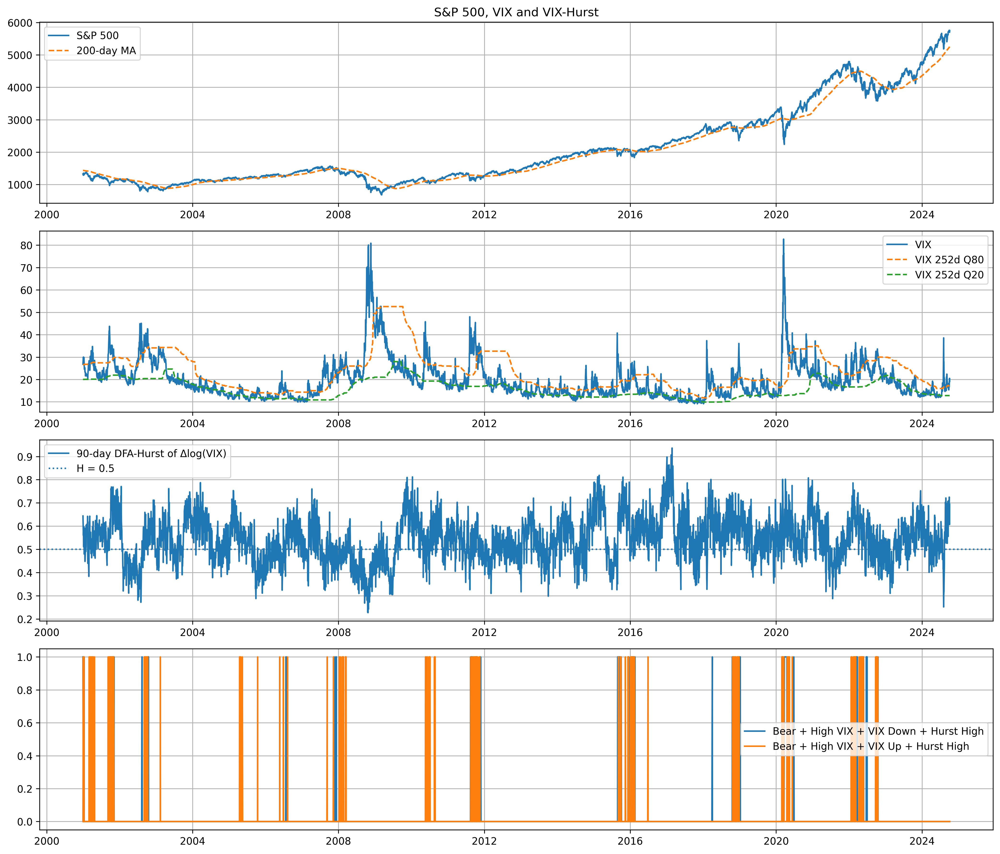
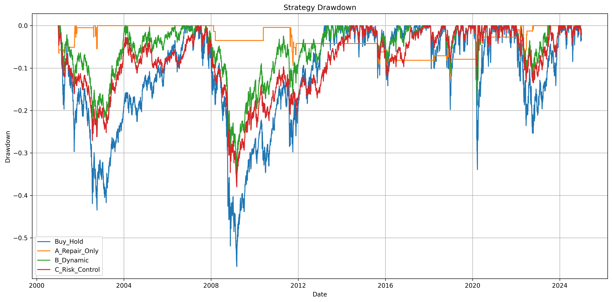

# Identifying Risk-Recovery Regimes in the S&P 500
### A VIX–Hurst empirical research project | 基于 VIX–Hurst 的标普500风险修复状态识别

**Research status | 研究状态:** Undergraduate research project · preliminary **in-sample** findings · not peer reviewed.  
**Main study period | 主研究区间:** 2000–2024 · **Tools | 工具:** Python, pandas, NumPy, SciPy, statsmodels, Matplotlib.

## Overview | 项目概述

This project studies whether the **DFA-Hurst exponent of daily changes in log(VIX)** offers incremental information about potential risk-recovery regimes in the S&P 500, beyond conventional market indicators and VIX-level/directional measures. The aim is **risk-state identification**, not market-bottom prediction or a claim of profitable trading.

本项目研究对 VIX 对数变化率应用去趋势波动分析（DFA）得到的 Hurst 指数，能否在传统市场指标和 VIX 水平、方向信息之外，为标普500弱势市场的**风险修复状态识别**提供增量信息。研究目标不是预测市场最低点，也不将回测表现视为已验证的交易收益。

## Research design | 研究设计

- **State variables | 状态变量:** S&P 500 vs. 200-day moving average; VIX vs. its rolling 252-day 80th percentile; 5-day change in VIX. / 标普500相对200日均线的位置、VIX相对252日滚动80%分位的位置及VIX过去5日变化。
- **Volatility persistence | 波动率持续性:** Rolling DFA-Hurst of Δlog(VIX), with 45/60/90/120-trading-day windows; 90 days is the main specification. / 对 Δlog(VIX) 估计45/60/90/120日滚动 DFA-Hurst，以90日为主。
- **Core composite state | 核心组合状态:** Bear market + elevated VIX + falling VIX + Hurst(90d) > 0.5. / 熊市 + VIX高位 + VIX近5日回落 + 90日Hurst大于0.5。
- **Evaluation | 实证检验:** Forward 22/60-trading-day outcomes; nested models M1 (market), M2 (+ VIX), M3 (+ Hurst); supplementary allocation backtests and GLD/GVZ–USO/OVX analyses. / 检验未来22/60日结果，递进比较 M1、M2、M3，并进行仓位策略和黄金/原油扩展分析。

## Selected findings (in sample) | 主要样本内发现

| Evidence / 证据 | Reported result / 研究结果 |
|---|---|
| Bear-sample 60-day S&P 500 forward returns / 熊市样本未来60日收益 | Adjusted R²: **11.01% (M2) → 17.55% (M3)** (+6.54 percentage points) |
| Composite signal frequency / 核心状态出现频率 | **170 days (2.84%)** for high-and-falling VIX + high Hurst |
| Illustrative dynamic-allocation strategy / 动态仓位策略示例 | Annual return **3.91%**, annual volatility **10.83%**, max drawdown **−34.43%**; buy-and-hold: **6.43%**, **19.29%**, **−56.78%** |

These are descriptive and **in-sample** results from the supplied outputs; they do **not** demonstrate out-of-sample incremental forecasting, a causal effect, or executable investment performance. The group comparison is against other bearish observations rather than a matched low-Hurst control.

以上为已有结果表中的**样本内**发现，不代表已证明样本外预测增益、因果关系或可执行投资收益。现有分组比较主要以其余熊市交易日为对照，尚非严格匹配的低 Hurst 对照组。

## Visual highlights | 代表性图表

**Figure 1. Market conditions and signals | 市场状态与组合信号**



**Figure 4. Nested-model AIC comparison (in sample) | 递进模型样本内 AIC 比较**


**Figure 6. Strategy drawdowns (illustrative) | 策略回撤对比（应用示例）**



[All nine figures / 全部九张图片](results/figures/) · [All seven tables / 全部七张表格](results/tables/)

## Repository guide | 文件导航

| Directory / 目录 | Contents / 内容 |
|---|---|
| [`src/`](src/) | Three research scripts: main empirical analysis, strategy application and optional gold/oil extension / 三份实证、回测和扩展检验脚本 |
| [`results/figures/`](results/figures/) | Nine original output charts / 九张原始结果图 |
| [`results/tables/`](results/tables/) | Seven reported tables in CSV / 七张结果表 CSV |
| [`data/`](data/) | Supplied price and volatility-index CSVs / 已提供的市场数据 |
| [`docs/research-summary.md`](docs/research-summary.md) | Bilingual standalone research brief; no thesis PDF / 中英双语研究简报，不包含论文全文 |
| [`docs/reproducibility.md`](docs/reproducibility.md) | Setup, data dependencies, and checks still required / 运行说明、数据依赖与待验证事项 |

## Quick start | 运行方法

Requires Python with internet access to retrieve `VIXCLS`, `GVZCLS`, and `OVXCLS` from FRED. / 运行时需联网从 FRED 获取隐含波动率序列。

```bash
python -m pip install -r requirements.txt
python src/01_main_spx_vix_hurst_empirical.py
python src/02_strategy_application.py
python src/03_gold_oil_extension_optional.py
```

Generated files are written to `outputs/` (excluded from Git). / 新生成的结果会写入 `outputs/`，不纳入版本控制。

## Limitations & sharing | 局限性与共享说明

- The uploaded scripts and output tables have **not** been independently verified by a full end-to-end rerun; out-of-sample validation remains pending. / 尚未独立完成全流程复现和样本外检验。
- Overlapping 22/60-day outcomes affect inference. OLS uses HAC covariance; descriptive group tests still use ordinary Welch tests. / 22/60日未来窗口存在重叠；OLS使用HAC标准误，但分组检验尚未进行相应依赖修正。
- The forward `mdd_fwd` metric measures the minimum return **from the signal date**, not standard peak-to-trough drawdown. / 前瞻`mdd_fwd`并非严格意义的区间峰谷最大回撤。
- The full thesis is intentionally not distributed here. Before any public release, verify data-redistribution permissions and the target journal's policies. / 此处不发布论文全文；公开前需核实数据许可和目标期刊政策。

This repository is a research record, **not investment advice**. / 本仓库仅作学术研究记录，不构成投资建议。
